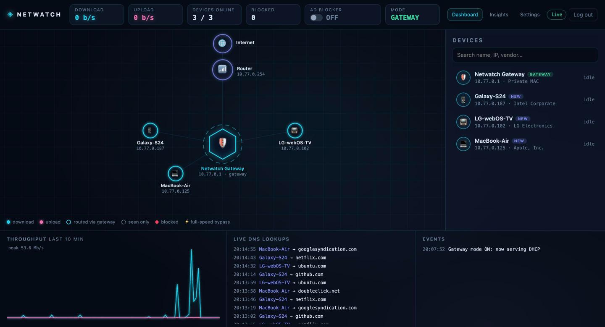
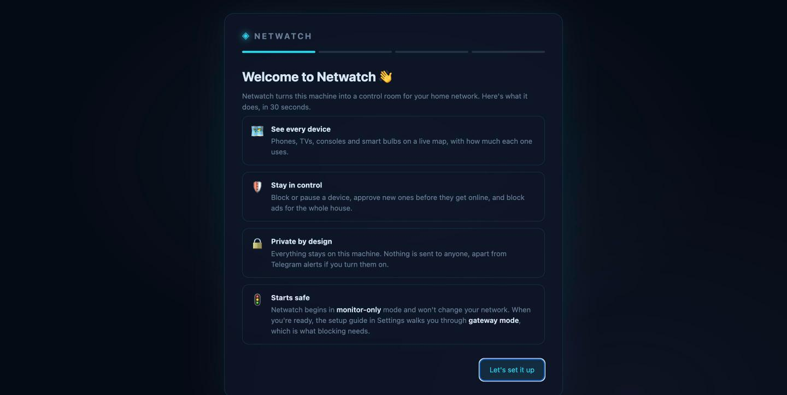
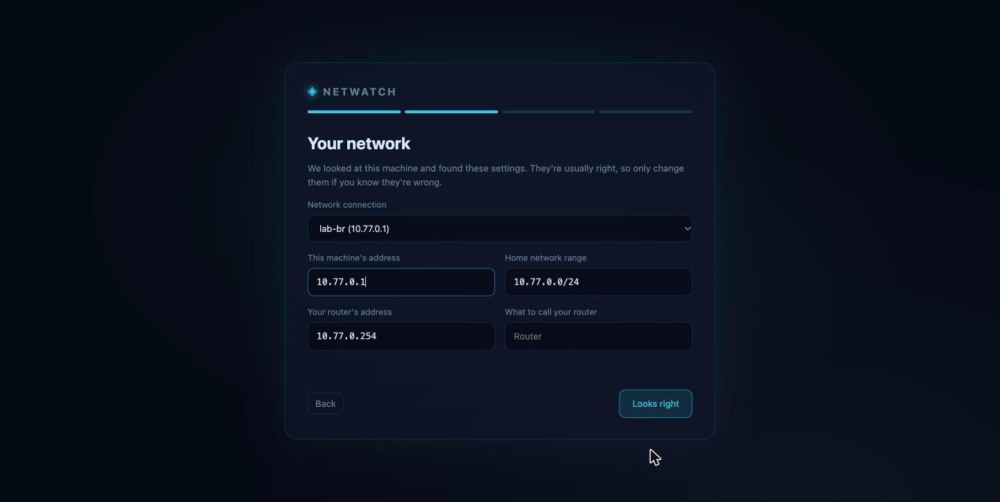

# Netwatch

**Turn a spare computer into a control room for your home network.** See every device on a live map,
approve new ones before they get online, pause the kids' tablet at bedtime, and block ads for the whole house:
from a web dashboard, or from Telegram on your phone.



[](https://github.com/ahmedjanwar/netwatch-oss/actions/workflows/ci.yml)
[](LICENSE)

## Install

On an always-on Ubuntu or Debian machine connected to your home network (an old laptop, a mini PC, a
home server):

```sh
curl -fsSL https://raw.githubusercontent.com/ahmedjanwar/netwatch-oss/main/install.sh | sudo bash
```

The installer sets up Docker if needed, starts Netwatch and prints the dashboard's address and a temporary
password. **It doesn't change your network:** Netwatch starts in monitor-only mode.

Open the address, sign in, and Netwatch walks you through the rest:

| 1. Choose your own password | 2. Check what was detected | 3. Pick features |
|---|---|---|
| The temporary password only works until you replace it. | Network, this machine's address and your router are detected for you. | Ad blocker, approval for new devices, Telegram alerts. |

<p align="center">
  
  
</p>

## What it does

- **Live map of every device**, with download and upload speeds, names and manufacturers.
- **New-device approval:** a device joining for the first time stays offline until you allow it.
- **Block, pause or give full speed** to any device, with timers ("pause until tomorrow morning").
- **Ad and tracker blocking** for the whole network, with an allowlist.
- **Insights:** who used what, busiest hours, top services (YouTube, Netflix…), latency and outages.
- **Telegram bot:** alerts with buttons, daily reports with charts, and remote control.
- **Private:** everything stays on your machine. No cloud, no account, no telemetry.

## How it works

Netwatch has two modes:

**Monitor only** (the default). Netwatch watches the network from the side: it sees which devices are online
and, for devices that use it for DNS, what they look up. It doesn't change anything.

**Gateway mode** (when you're ready). Netwatch takes over handing out addresses on your network and names
itself as every device's gateway and DNS server, so all traffic flows through it:

```
phones, TVs, laptops ──► Netwatch ──► your router ──► internet
```

That's what lets it measure each device's traffic and block devices or ads. The **setup guide** in
*Settings* walks you through it with live checks:
1. Give the Netwatch machine a fixed address (`sudo netwatch static-ip`).
2. Turn off DHCP (and IPv6 on the LAN) in your router's settings.
3. Turn on gateway mode.
4. Reconnect your devices.

> **Gateway mode makes this machine important:** if it's off, devices can't get online until you turn your
> router's DHCP back on. Use a machine that stays on, preferably with a wired connection.
> **To undo everything:** turn your router's DHCP back on, then run `sudo netwatch gateway off`.

## Updating

Netwatch has numbered releases ([see what's new](https://github.com/ahmedjanwar/netwatch-oss/releases)).
To update to the latest one:

```sh
sudo netwatch update     # installs the latest release, with a self-test and automatic rollback
sudo netwatch version    # what you're running, and whether a newer release is out
```

**Channels:** by default you're on **stable**, which only gets releases. If you'd like to try changes as
soon as they land on `main` and report problems, switch to **edge**, and back whenever you like:

```sh
sudo netwatch channel edge     # follow main (for testers)
sudo netwatch channel stable   # back to releases
```

## Commands

```
sudo netwatch status           is it running, where's the dashboard, which version
sudo netwatch version          the installed version, and whether a newer one is out
sudo netwatch password         show the temporary password from the installer
sudo netwatch reset-password   forgot your password? get a new temporary one
sudo netwatch logs             follow the logs
sudo netwatch static-ip        give this machine a fixed IP (before gateway mode)
sudo netwatch gateway on|off   switch gateway mode
sudo netwatch update           update to the latest release, with a self-test and rollback
sudo netwatch channel edge     follow main instead of releases (stable to go back)
sudo netwatch uninstall        remove Netwatch
```

## Requirements

- Ubuntu or Debian with systemd. Tested on **Ubuntu 24.04**; other versions
  with Docker Compose v2 should work. Reports welcome.
- About 1 GB of free disk for Docker and the Netwatch image
- A wired connection is strongly recommended for gateway mode
- Your router's admin login, to turn its DHCP off for gateway mode

## Good to know

- **IPv6:** if your router advertises itself over IPv6, devices may use your internet provider's DNS and
  skip Netwatch (and its ad blocker). Setup warns you and explains how to turn it off.
- **Blocking** cuts a device's internet but keeps it on your home network. A tech-savvy user could get
  around it by setting their gateway by hand.
- **Port forwarding** on your router won't reach devices behind Netwatch.
- **Casting and AirPlay** go directly between devices, so that traffic doesn't show on the dashboard.

## Contributing

Bug reports, ideas and pull requests are welcome: see [CONTRIBUTING.md](CONTRIBUTING.md). Every pull
request runs the tests in [`tests/`](tests/), including any you add.
The [`lab/`](lab/) folder has a virtual machine with a fake home network (a router, a phone, a TV and a
laptop), so you can try changes without touching your own network.

Found a security problem? Please report it privately: see [SECURITY.md](SECURITY.md).

## License

[MIT](LICENSE)
